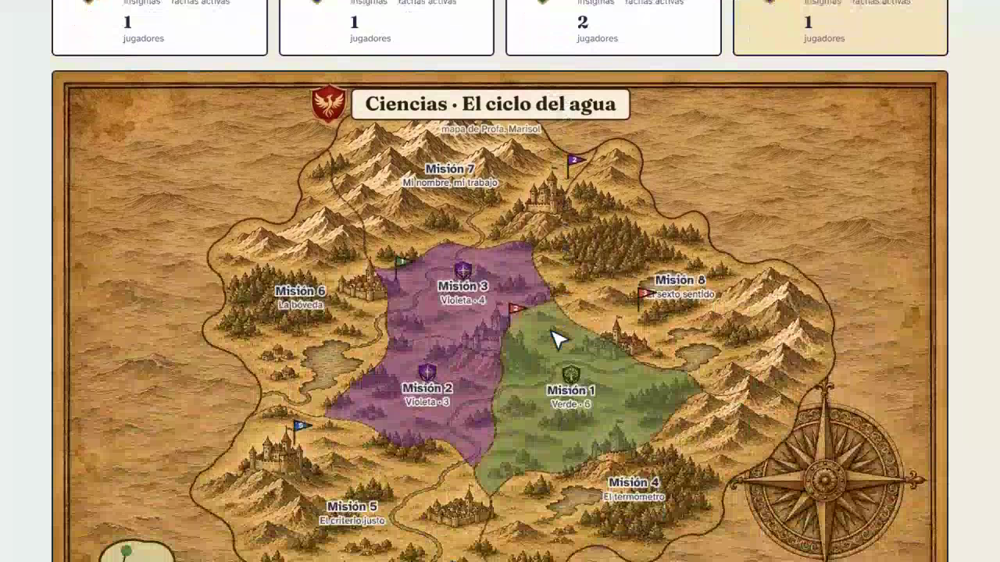
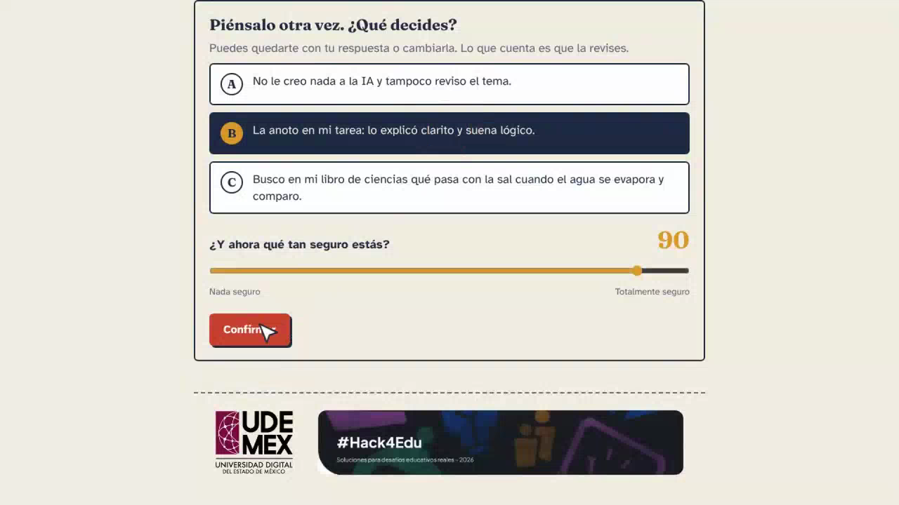
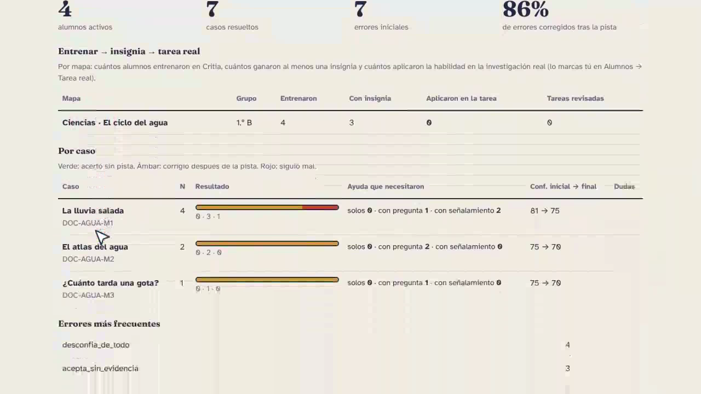

# Critia · La expedición

**Un acompañante para aprender a revisar las respuestas de la IA mientras se hace una tarea de investigación.**

Critia es un prototipo educativo para estudiantes de **11 a 17 años**, presentado en **Hack4Edu 2026, Reto 04: «Un tutor que no te da la respuesta»**. El alumno decide, declara su confianza, recibe pistas y revisa su respuesta. El docente observa qué ayuda necesitó y lee sus reflexiones.

[Abrir la demo](https://hackaton.proyecto.digital/) · [Guía para docentes](https://hackaton.proyecto.digital/guia.html) · [Ver el video de presentación](https://filedn.com/lzob2HCMOzYmKrnRoiB89Q8/WhatsApp%20Video%202026-11-05%20at%207.40.58%20PM.mp4) · [Instalar en local](#instalar-en-local)



*Universo del prototipo: cada mapa representa una materia o tema. Captura extraída del video de presentación; los datos son de demostración.*

## Ver una demostración

### Explorar en línea

Abre [hackaton.proyecto.digital](https://hackaton.proyecto.digital/). La portada y la [guía docente](https://hackaton.proyecto.digital/guia.html) se pueden consultar sin iniciar sesión.

Para recorrer los ejercicios como alumno necesitas un **código de grupo proporcionado por el docente o por quien administra la demostración**, un seudónimo y un equipo. El panel docente requiere una cuenta creada por el administrador. Este README no publica cuentas ni códigos de grupo compartidos.

La demo en línea puede actualizarse independientemente de esta copia del código. Si no tienes acceso a un grupo, puedes ver el video o preparar una prueba local con los pasos de abajo.

### Ver el recorrido en video

El [video de presentación](https://filedn.com/lzob2HCMOzYmKrnRoiB89Q8/WhatsApp%20Video%202026-11-05%20at%207.40.58%20PM.mp4) muestra la preparación docente, un caso del ciclo del agua, las pistas, el mapa por equipos y el seguimiento. Dura aproximadamente tres minutos. Se aloja fuera del repositorio; si no se reproduce en el navegador, descárgalo y ábrelo en tu reproductor.

## Cómo funciona

1. **El docente prepara la actividad.** Crea un grupo y un mapa para su materia o tema. Puede utilizar el banco base o generar borradores de ejercicios para revisarlos y asignarlos.
2. **El alumno registra su decisión.** Lee una respuesta de IA presentada en un caso, elige una opción, indica su confianza de 0 a 100 y escribe una razón.
3. **El tutor ofrece ayuda.** Usa preguntas generales o pistas más concretas según la respuesta, la confianza y ciertos antecedentes. El alumno también puede pedir una pista antes de decidir.
4. **El alumno revisa y reflexiona.** Puede mantener o cambiar su respuesta. Al cerrar el recorrido recibe la explicación y una pregunta de reflexión. Las pistas buscan que razone antes de mostrar esa explicación.
5. **El docente consulta el proceso.** Revisa decisiones, ayuda recibida y reflexiones. Puede otorgar insignias y registrar si observó la aplicación de una habilidad en la tarea real.

El banco base de esta copia contiene **30 casos: 27 de opción múltiple y tres de reflexión abierta**, organizados en ocho misiones y tres niveles de edad. Las insignias y los territorios acompañan la práctica; no equivalen por sí solos a una medida validada de aprendizaje.

## Capturas del prototipo

### Decisión y confianza



*Ejemplo del video: el estudiante puede revisar tanto su opción como su confianza.*

### Seguimiento docente



*Datos de demostración. Los porcentajes de esta captura ilustran el panel; no son resultados de un piloto educativo.*

Las tres capturas se extrajeron de [el video de presentación](https://filedn.com/lzob2HCMOzYmKrnRoiB89Q8/WhatsApp%20Video%202026-11-05%20at%207.40.58%20PM.mp4). Su resolución y encuadre corresponden al video fuente.

## Versión actual: rediseño de juego (noviembre de 2026)

Esta versión cambia la experiencia del alumno y del docente. Las capturas de la sección anterior corresponden al diseño previo, extraído del video; todavía no se han sustituido.

**Para el alumno**

- **El caso en pasos cortos.** Un paso por pantalla: leer, decidir, seguridad, pista del tutor, revisar, resultado y reflexión. Barra de avance, botón principal fijo abajo y animaciones breves, que se desactivan si el dispositivo pide reducir el movimiento.
- **Mapa ilustrado de territorios.** Un continente con ocho territorios y la isla del detective. Cada territorio se tiñe con el color del equipo que lo controla y muestra el avance del alumno. Al tocarlo se abren sus casos y los puntos de cada equipo.
- **Barra de navegación** con tres secciones: Mapa, Equipo e Insignias. El Universo usa el mismo mapa para todas las materias del grupo.
- **Misión de hoy.** Tres casos por día, con avance visible y un resumen al cumplirla. No bloquea seguir jugando.
- **Puntos con una sola regla** en el mapa, el caso y la página Equipo: un punto por cada habilidad ganada (justificar, revisar, calibrar) y uno más por resolver sin pistas. Antes de jugar, el caso explica cómo se suman; corregir después de una pista también cuenta.
- **Ruta recomendada** en el mapa, en el orden de las misiones. Es una sugerencia, no un bloqueo.
- **Retomar un caso.** Si el alumno recarga la página a medio caso, vuelve al paso donde se quedó.
- **Historia corta.** El alumno es un explorador que revisa lo que responde una IA antes de que su equipo lo use. Cada territorio tiene un lugar y dos líneas de historia, que se muestran la primera vez que entra.
- **Reto de equipo semanal.** Casos bien revisados entre todos, de lunes a domingo. La meta es de tres casos por jugador, con un mínimo de seis. Es un logro compartido: no da puntos.
- **Seguridad como armadura.** El alumno declara su seguridad en cuatro niveles: 25, 50, 75 y 100. Un guerrero lleva más armadura con cada nivel, de ninguna a completa. Hay que elegir un nivel antes de decidir.
- **Medidor de puntería.** Al cerrar un caso se indica si la seguridad declarada coincidió con la primera respuesta; la página Insignias muestra el acumulado. Cuentan como «seguro» los niveles 75 y 100.
- **Tema oscuro de juego** en las pantallas del alumno. La portada, la guía y el panel docente conservan el tema claro.

**Para el docente**

- **Inicio con un solo campo:** el tema de la clase. Un asistente de tres pasos crea la actividad, prepara un caso por territorio, los muestra uno por uno para aprobar, editar o descartar, y termina con el código del grupo y las instrucciones para los alumnos.
- **Cuatro secciones** en lugar de nueve pestañas: Inicio, Por revisar, Seguimiento y Ajustes.
- La generación por tema envía cada caso a su territorio. Antes, un postulado compartido por dos misiones mandaba el caso siempre a la primera.

**Cómo se comprobó.** Los recorridos del alumno y del docente se probaron en un navegador automatizado, en tamaño de celular y de escritorio, con datos de prueba. El asistente de generación se probó con respuestas simuladas del modelo: **falta probarlo con una clave real del proveedor**. El repositorio sigue sin pruebas automáticas.

## Siguiente versión

Trabajo planeado, todavía sin construir:

1. **Nuevos tipos de caso,** además de la opción múltiple: señalar la frase dudosa de la respuesta de la IA u ordenar qué revisar primero.
2. **Dificultad por caso,** para que la ruta recomendada vaya de fácil a difícil y no solo en el orden de las misiones.
3. **Pendientes antes de un piloto:** reforzar la identidad del alumno al volver a entrar; validar los casos editados antes de guardarlos; incluir el bono de racha en la página Equipo; permitir que el docente cambie la meta diaria; equilibrar las claves de los ocho casos del ciclo del agua (todas están en C); sustituir las capturas de este README; revisar accesibilidad con lector de pantalla.

## Cómo está construido

| Componente | Tecnología | Función |
| --- | --- | --- |
| Interfaz | HTML, CSS y JavaScript | Pantallas del alumno, panel docente, mapa ilustrado con capa SVG de territorios, insignias y Universo; sin compilación de frontend. |
| Servidor | Python y FastAPI | API, acceso a grupos y coordinación de la actividad. |
| Tutor explicable | Reglas ASP y clingo | A partir de hechos estructurados, selecciona una intervención, su motivo y la intensidad inicial de ayuda. |
| Registro | SQLite | Guarda intentos, decisiones, confianza, pistas y revisiones. |
| Contenido | JSON | Banco de ejercicios, habilidades, misiones y criterios de reflexión. |
| Generación docente | API compatible con chat completions; DeepSeek por defecto | Propone borradores con filtros automáticos y revisión docente. |

**El modelo generativo y el tutor tienen funciones distintas.** Durante los ejercicios base, el tutor utiliza reglas y textos definidos. Python coordina la secuencia de decisiones y pistas. La API del modelo externo se usa para preparar ejercicios nuevos; no es necesaria para recorrer el banco base.

## Instalar en local

Ejecuta los comandos desde la raíz del proyecto, donde está este README. El contenedor toma como referencia **Python 3.12**. Puedes elegir entre un entorno Python y Docker.

### Opción A · Python

En macOS o Linux:

```bash
python3 -m venv venv
source venv/bin/activate
python -m pip install -r backend/requirements.txt
export ADMIN_TOKEN='sustituye-por-una-clave-larga-y-unica'
cd backend
python -m uvicorn main:app --reload --host 127.0.0.1 --port 8000
```

Sustituye la clave del ejemplo antes de ejecutar los comandos y guárdala para entrar como administrador. `ADMIN_TOKEN` es obligatorio, debe tener al menos seis caracteres y no puede ser `docente`. El servidor rechaza el arranque si no se cumple esta condición.

En PowerShell, activa el entorno con `venv\Scripts\Activate.ps1` y define la variable con `$env:ADMIN_TOKEN = 'tu-clave-administrativa'`; los comandos de instalación y arranque con `python` son los mismos.

Abre [localhost:8000](http://localhost:8000/). Para esta opción, las variables se configuran en la terminal: el comando mostrado **no carga automáticamente un archivo `.env`**.

### Opción B · Docker Compose

Con Docker y Docker Compose instalados:

```bash
cp .env.ejemplo .env
```

Edita `.env` y establece un `ADMIN_TOKEN` propio. Si solo vas a probar el banco base, deja `LLM_API_KEY=` vacío en lugar de la clave ficticia del ejemplo. Después ejecuta:

```bash
docker compose up --build
```

Abre [localhost:8000](http://localhost:8000/). Docker Compose utiliza `.env` para completar la configuración. La base SQLite se conserva en el volumen `critia_data`; los casos generados se guardan mediante el montaje de `backend/casos/docente/`.

## Preparar la primera prueba

No necesitas una clave de DeepSeek para este recorrido:

1. Con el servidor encendido, abre [el panel local](http://localhost:8000/docente.html). Deja el usuario vacío y entra con el valor de `ADMIN_TOKEN` como contraseña.
2. Crea una cuenta docente. Cierra la sesión administrativa y entra con esa cuenta.
3. En **Inicio**, escribe el tema de la actividad. Si todavía no tienes grupos, escribe el nombre del grupo y elige la edad de los alumnos: 11 a 12 años, 13 a 14 o 15 a 17.
4. Presiona **Crear actividad**. Sin clave del modelo, la actividad usa el banco base. Al terminar, el panel muestra el código del grupo y las instrucciones para los alumnos.
5. Abre otra ventana del navegador, preferentemente privada, y entra a la portada con ese código, un seudónimo ficticio y un equipo. Elige el mapa y abre un caso disponible.
6. Registra una respuesta y su confianza. Para observar la escalera de ayuda, puedes elegir deliberadamente una opción incorrecta y revisar después. Guarda una reflexión al terminar.
7. Regresa al panel docente y consulta **Seguimiento** (Resumen y Alumnos) y **Por revisar** (Reflexiones) para comparar la decisión inicial, la ayuda y la decisión revisada.

La [guía docente en línea](https://hackaton.proyecto.digital/guia.html) describe el uso en clase; en la instalación local también está disponible en [localhost:8000/guia.html](http://localhost:8000/guia.html).

### Probar la generación de casos

Configura `LLM_API_KEY` antes de iniciar el servidor. Desde la cuenta docente, escribe el tema en **Inicio** y presiona **Crear actividad**: el panel prepara un caso por territorio y te los muestra uno por uno para aprobar, editar o descartar. Para elegir postulados, nivel y cantidad a mano, usa **Ajustes → Generar con opciones**; esos borradores se aprueban en **Por revisar → Casos**. La generación requiere conexión al proveedor y puede tener un costo según la cuenta utilizada.

Los [ocho ejemplos del ciclo del agua](backend/casos/ejemplos/casos_docente_demo_ciclo_agua.json) se distribuyen aparte y no se cargan automáticamente. Si quieres utilizarlos, copia el archivo a `backend/casos/docente/`, cambia su campo `docente` por tu usuario y, para recorrer la revisión como borradores, cambia `provisional` a `true` y `revisado_por_docente` a `false`. Después revísalos y asígnalos desde el panel. Estos ejemplos tienen todas las claves correctas en C; conviene equilibrarlas antes de utilizarlos en pruebas con estudiantes.

## Configuración

| Variable | Uso |
| --- | --- |
| `ADMIN_TOKEN` | Clave administrativa obligatoria. `DOCENTE_TOKEN` se acepta como alias. |
| `SEXTO_DB` | Ruta de SQLite. Por defecto, `backend/historial.db`; en Docker, `/data/historial.db`. |
| `LLM_API_KEY` | Clave del proveedor, necesaria solo para generar casos. |
| `LLM_BASE_URL` | URL de la API del modelo; por defecto, `https://api.deepseek.com`. |
| `LLM_MODEL` | Modelo utilizado por el generador; por defecto, `deepseek-chat`. |
| `APP_VERSION` | Identificador que se añade a los recursos web para actualizar su caché. |

### Rutas principales

| Ruta | Acceso |
| --- | --- |
| `/` | Portada y entrada del alumno; con sesión, el mapa de territorios. |
| `/caso.html?id=...` | Ejercicio; requiere una sesión de alumno y un caso disponible. |
| `/insignias.html` | Insignias del alumno. |
| `/tablero.html` y `/universo.html` | Puntos por equipo y territorios de todas las materias; los enlaces del grupo incorporan sus parámetros. Sin sesión de alumno sirven para proyectar en el salón. |
| `/docente.html` | Acceso docente y administrativo. |
| `/guia.html` | Guía para docentes. |
| `/docs` | Documentación interactiva de la API FastAPI. |

## Estructura del proyecto

```text
backend/
  main.py             API FastAPI
  sesion.py           Decisiones, pistas y cierre del intento
  motor.py            Preparación de hechos y consulta del solver
  historial.py        SQLite, grupos, mapas y seguimiento
  generador.py        Borradores de ejercicios con modelo externo
  misiones.json       Misiones (con su lugar e historia), postulados, habilidades y niveles
  asp/                Reglas de diagnóstico y tutoría
  casos/casos.json    Banco base
  casos/docente/      Casos adicionales generados o importados
  casos/ejemplos/     Ejemplos para preparar una demostración
frontend/             HTML, CSS, JavaScript e ilustraciones
  assets/css/juego.css      Pantallas de juego del alumno y tema oscuro
  assets/js/mapa.js         Fronteras de los territorios, alineadas con la ilustración
  assets/img/mapa_territorios.jpg   Ilustración del mapa
docs/capturas/        Capturas utilizadas en este README
Dockerfile            Imagen del servicio
docker-compose.yml    Ejecución con volumen persistente
respaldo.sh           Respaldo de SQLite y casos en el VPS
```

Las reglas de juego están en `backend/historial.py`: `META_DIARIA = 3` (casos de la misión de hoy), `RETO_POR_JUGADOR = 3` y `RETO_MINIMO = 6` (reto semanal de equipo), `SEGURO_DESDE = 60` (umbral de la puntería), `RACHA_PARA_DETECTIVE = 3`, `CASOS_PARA_INSIGNIA = 2` y la función `puntos_territorio`, que define los puntos de cada caso. Una insignia se sugiere con dos casos distintos del mismo postulado resueltos sin pista en el mismo mapa; el docente decide si la otorga. La cobertura disponible depende del nivel y de los casos asignados.

## Alcance y estado del prototipo

Critia no ha pasado por un piloto con estudiantes ni cuenta con evidencia de eficacia educativa. Corregir una respuesta después de la pista muestra revisión en ese ejercicio; no demuestra transferencia a casos nuevos. La aplicación no interpreta ni califica automáticamente el razonamiento escrito, no verifica fuentes en Internet, no detecta contenido manipulado y no sustituye al docente.

El navegador necesita alcanzar un servidor; no es una aplicación autónoma sin conexión. La generación requiere un proveedor externo. Los filtros y la segunda llamada al mismo modelo comprueban aspectos de estructura y consistencia, no garantizan la veracidad de los ejercicios.

### Acceso y datos

El servidor utiliza tokens de alumno y docente, comprueba la propiedad de los intentos y bloquea la reescritura de decisiones cerradas. Las sesiones docentes caducan a las 12 horas; los fallos de inicio de sesión tienen un bloqueo temporal. El frontend incorpora escape de texto para su inserción en HTML.

Quedan pendientes mejoras antes de las pruebas con estudiantes, entre ellas reforzar la identidad del alumno al volver a entrar y validar casos editados antes de guardarlos. Los puntos del alumno ya usan una sola regla; el bono de racha todavía se suma solo en el mapa. El reingreso actual se basa en grupo, seudónimo y equipo; esos datos no equivalen a una credencial individual. Utiliza información ficticia en las demostraciones y revisa la configuración antes de un uso real.

<details>
<summary>Operación del VPS y respaldos</summary>

La configuración `docker-compose.traefik.yml` está preparada para un entorno que ya tenga Traefik, dominio y HTTPS configurados. No instala por sí sola ese proxy.

El script `respaldo.sh` presupone el proyecto en `/opt/critia` y un contenedor llamado `critia`. Para programarlo en ese entorno:

```bash
chmod +x /opt/critia/respaldo.sh
(crontab -l 2>/dev/null; echo "15 3 * * * /opt/critia/respaldo.sh >> /var/log/critia-respaldo.log 2>&1") | crontab -
```

Guarda una copia de la base SQLite y los casos generados en `/opt/critia-respaldos/critia-AAAA-MM-DD.tar.gz`, con retención de 30 días. El comando añade una entrada al cron; evita ejecutarlo repetidamente para no duplicar la programación.

La configuración anterior utilizaba el volumen `sexto_data`; esta utiliza `critia_data`. Si actualizas una instalación existente, respalda y migra los datos: el volumen nuevo no recupera automáticamente el anterior. También cambian identificadores del banco base; conserva una copia del historial antes de migrarlo.

</details>


## Procedencia del trabajo

Las bases de Hack4Edu 2026 piden identificar qué existía antes del hackatón y qué se desarrolló durante él.

**Antes del hackatón: Sexto Sentido (documento de diseño, octubre–noviembre de 2026).** Un informe técnico-pedagógico, orientado entonces al Reto 07, que describía un prototipo *objetivo* (no ejecutado ni validado, como el propio documento aclara): un tutor de consola en Python con motor de decisión en Answer Set Programming (DLV), un banco previsto de 23 problemas de razonamiento, 4 actividades escolares y 8 escenarios de alfabetización en IA (AI-LIM-001 a 008), el ciclo decisión → confianza → intervención → revisión → explicación, la separación entre clave editorial y política pedagógica, y los límites de seguridad (no diagnosticar psicológicamente, no calificar prosa automáticamente). De ahí Critia conserva **las ideas**: el ciclo de interacción, la tutoría explicable por reglas ASP con acción y motivo, los 12 postulados de pensamiento crítico y la familia de errores. No se reutilizó código de Sexto Sentido: no existía una implementación funcional.

**Durante el hackatón (Critia, 4–5 de noviembre de 2026), desarrollado desde cero:**
- Backend FastAPI + SQLite, motor clingo con `diagnostico.dlv` y `tutor.dlv`, máquina de estados de intentos, sesiones de alumno y docente, controles de acceso.
- Frontend web (mapa de expedición, caso, insignias, tablero, Universo, panel docente, guía) con diseño propio.
- Banco de 30 casos escritos para este proyecto, centrados en respuestas de IA, en tres niveles por edad y con habilidad/autor explícitos (Paul y Elder, Facione, Ennis, Lipman).
- Generador supervisado de casos con DeepSeek (filtros automáticos + aprobación docente), grupos compartidos, mapas por profesor, insignias por habilidad, territorios y Universo, bono de racha e isla del detective.
- Despliegue en Hostinger (Docker + Traefik) en https://hackaton.proyecto.digital, respaldos diarios.
- Reorientación al **Reto 04 "Un tutor que no te da la respuesta"** y la secuencia didáctica "entrenar antes de investigar".

## Créditos y atribución

- Autor y dirección del proyecto: Erandi Carrasco Alcántara (Universidad Digital del Estado de México, Hack4Edu 2026).
- Código y contenidos redactados con asistencia de IA (Claude, Anthropic) bajo dirección y revisión del autor.
- Guerrero de los niveles de seguridad: generado con Higgsfield a partir de indicaciones del autor.
- Ilustración del mapa de territorios: generada con Higgsfield a partir de un trazado propio de las fronteras; el continente y sus territorios son originales de Critia. Ilustraciones anteriores del Universo (continente y mar) e insignias: generadas con Higgsfield a partir de indicaciones del autor. Escudos de equipo: aportados por el autor.
- Logotipo de UDEMEX: propiedad de la Universidad Digital del Estado de México; se usa con fines institucionales del proyecto.
- Modelo de lenguaje para generación de casos: DeepSeek (API). Motor lógico: clingo (Potassco).
- Licencia del código: MIT (ver `LICENSE`). Los casos, la guía y los textos pedagógicos se comparten bajo la misma licencia.
